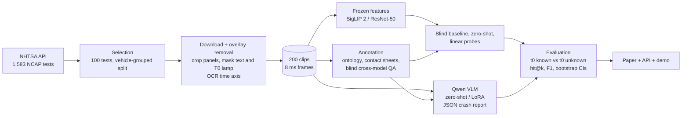

# CrashVLM

**Can open vision-language models read a crash test video, and how much of what they "see"
is just the clock?**

CrashVLM is a research prototype for evaluating vehicle crash test videos with vision-language
models. It is built on the public NHTSA NCAP database: 100 frontal, side-barrier and side-pole
tests, with two high-speed camera views each. It contains:
- an open data pipeline, including overlay removal with an automated leak check and OCR time
  recovery;
- a frame-level event ontology and 200 annotated views, with documented label-quality checks;
- a leakage-aware evaluation protocol;
- baselines from a blind no-video predictor through SigLIP 2 probes to Qwen VLMs that write
  structured JSON crash reports;
- a FastAPI service, a Gradio demo and a workshop-paper draft.

> **Status.** Data, annotation, CPU baselines, API/demo and paper draft are done. The GPU runs
> (SigLIP 2 so400m, Qwen zero-shot, LoRA) are fully scripted and smoke-tested, and waiting for a
> Colab session ([docs/COLAB.md](docs/COLAB.md)). Results below are generated from `reports/`
> by `scripts/paper_tables.py`; nothing is typed in by hand.



> **Demo GIF: placeholder.** To be recorded from the Gradio app (`python -m crashvlm.serve.demo`).
> NHTSA frames are not redistributed in this repository.

## Results

<!-- results:start -->
Hit@16 (share of test events timed within 16 ms; misses count) on the 23-test split.
**t0 unknown**: clips cropped at a random start, as for any real video.

| Method | Impact | Airbag | Head contact | Windshield crack | Side glass |
|---|---|---|---|---|---|
| Blind (no video) | 0.75 | 0.75 | 0.67 | 0.75 | 0.45 |
| ResNet-50 + probe | 0.75 | 0.45 | 0.44 | 0.50 | 0.27 |
| SigLIP 2-B zero-shot | – | 0.45 | 0.33 | 0.25 | 0.00 |
| SigLIP 2-B + probe | 0.55 | 0.60 | 0.50 | 0.62 | 0.27 |
| SigLIP 2-So400m zero-shot | – | 0.35 | 0.28 | 0.12 | 0.00 |
| SigLIP 2-So400m + probe | 0.45 | 0.70 | 0.50 | 0.62 | 0.45 |

With the lab clock (**t0 known**), the blind no-video baseline scores 1.00 (airbag) and 0.94 (head contact).

**Video VLMs vs. the blind baseline** (same clips, t0 unknown; ↑/↓ = paired bootstrap interval excludes zero):

| Event | k (ms) | Blind | ResNet-50 probe | SigLIP 2-So400m probe | Qwen3.5-4B | Qwen3-VL-8B | Qwen3.5-4B LoRA |
|---|---|---|---|---|---|---|---|
| Impact | 8 | 0.35 | 0.45 | 0.20 | 0.20 | 0.20 | 0.65↑ |
| Impact | 16 | 0.75 | 0.75 | 0.45↓ | 0.20↓ | 0.40↓ | 0.90 |
| Airbag | 8 | 0.25 | 0.30 | 0.55 | 0.70↑ | 0.90↑ | 0.80↑ |
| Airbag | 16 | 0.75 | 0.45 | 0.70 | 0.75 | 0.90 | 0.90 |
| Head contact | 8 | 0.22 | 0.22 | 0.17 | 0.33 | 0.11 | 0.56 |
| Head contact | 16 | 0.67 | 0.44 | 0.50 | 0.39 | 0.17↓ | 0.83 |

Report quality, hallucination and latency: `reports/m4/results.md`; intervals: `reports/m4/paired.md`.
<!-- results:end -->

## Findings (honest version)

1. **The clock gives the answer away.** NCAP tests are so standardised that a predictor which
   never looks at the video times airbag deployment within 16 ms in almost every test case, once
   the lab's impact time is known. Timing benchmarks on standardised crash tests are
   meaningless without this baseline.
2. **Even without the clock, the prior is strong, and frozen features don't beat it.** A blind
   baseline trained on the same random start crops as the test clips still times impact and
   airbag within 16 ms in 75 % of cases. No linear probe or zero-shot encoder does better.
   (An earlier version of this baseline was measured on uncropped clips, which made it about
   20 ms late and too weak; fixing it overturned an earlier "probes win" claim.)
3. **Video VLMs beat the prior where precision matters.** Within 8 ms, all three Qwen models
   time airbag deployment significantly better than the prior (Qwen3-VL-8B: 0.90 vs 0.25), and
   a briefly LoRA-trained Qwen3.5-4B also times the impact better (0.65 vs 0.35). Zero-shot
   VLMs misplace the impact. Qwen3-VL-8B claims fire in 7 % of clips where there is none.
4. **Fine-tuning helps even when cut short.** On a free GPU, LoRA ran only 20 of 183 planned
   steps, yet it clearly improved impact timing (significant at 8 ms), and head contact
   (not significant), with fewer contradicting claims than zero-shot. Part of its impact
   gain is a better-calibrated prior (few distinct predicted values), which a full run and a
   human-verified test set would have to separate.
5. **Video can be checked against physics.** The car's own accelerometers give the measured
   moment of maximum crush for 94 tests. Visual labels and appearance-based models could not
   find it. Optical flow on the car body does: within 8 ms in all 12 held-out frontal tests,
   without using the lab clock ([reports/physics](reports/physics)).
6. **Data work beat model work.** Burned-in timestamps and a red→green impact lamp would have
   leaked the labels. Two OCR time-parsing bugs shifted 8 clips by about 50 ms. Same-model label
   agreement overstated reliability. Each was caught by an explicit check.

Details: [docs/FINDINGS.md](docs/FINDINGS.md) · label quality:
[docs/ANNOTATION_QA.md](docs/ANNOTATION_QA.md) · paper draft:
[paper/crashvlm_draft.pdf](paper/crashvlm_draft.pdf)

## Important limitation: who labelled the data

All 200 views were annotated by a language model (Claude), not by a human, from time-stamped
contact sheets under a written guideline. Quality was checked with blind re-annotation by
other model instances, and labels are used in reliability tiers. A human-verified subset is
the most important missing piece. See [docs/ANNOTATION_QA.md](docs/ANNOTATION_QA.md).

## Quick start

On a Mac with iCloud "Desktop & Documents" enabled, keep data and the virtual environment out of
the synced folders (iCloud otherwise throttles I/O and hides the environment's `.pth` files):

```bash
export CRASHVLM_DATA=~/crashvlm_data UV_PROJECT_ENVIRONMENT=~/.venvs/crashvlm
```

```bash
uv sync                                          # core (data pipeline, evaluation)
uv run python scripts/build_catalog.py           # NHTSA API -> catalog
uv run python scripts/select_tests.py            # frozen selection + split
uv run python scripts/prepare_clips.py           # download, overlay removal, frames
uv run python scripts/overlay_report.py          # QA sheets + T0-lamp leak check
uv sync --extra ml
uv run python scripts/extract_embeddings.py embed.backbone=siglip:google/siglip2-base-patch16-224
uv run python scripts/run_m3.py 'm3.backbones=[google__siglip2-base-patch16-224,resnet50]'
```

API and demo (CPU, probe backend):

```bash
uv sync --extra ml --extra serve
uv run python scripts/export_probes.py
uv run uvicorn crashvlm.serve.api:app --port 8000   # POST /evaluate_video
uv run python -m crashvlm.serve.demo                # Gradio UI
```

GPU steps (SigLIP 2 so400m, Qwen zero-shot, LoRA): [docs/COLAB.md](docs/COLAB.md).

## Repository

| Path | Content |
|---|---|
| `src/crashvlm/data` | NHTSA client, view selection, overlay removal, OCR time axis, clip extraction |
| `src/crashvlm/annotation` | ontology, CVAT I/O, pre-labels, direct labels, agreement metrics |
| `src/crashvlm/models` | SigLIP scorer, embeddings, probes, VLM runner and report parser |
| `src/crashvlm/train` | LoRA instruction data |
| `src/crashvlm/eval` | event metrics, bootstrap CIs, blind baseline, shared probe selection |
| `src/crashvlm/serve` | inference pipeline, FastAPI, Gradio |
| `configs/` | Hydra configs per milestone; `configs/splits/selection_v1.csv` is the frozen split |
| `annotations/` | labels and QA passes (model-produced) |
| `docs/` | data card, design decisions, annotation guideline and QA, findings, Colab cells |
| `paper/` | LaTeX draft, generated tables, verified bibliography |

## Data and licence

NHTSA footage is publicly accessible but its licence is listed as "unknown" on data.gov, and it
is produced by contract laboratories. This repository therefore contains no video or frames,
only code, test IDs, annotations and derived metrics. See [docs/DATA_CARD.md](docs/DATA_CARD.md).
