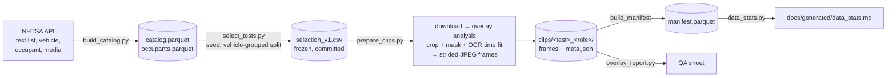
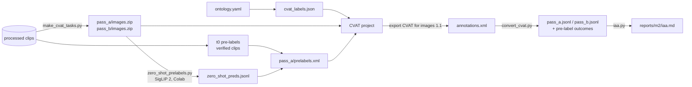

# Design notes

Living document: each milestone adds its decisions. Rationale first, then the rule it creates.

## M1: data pipeline

### Decisions

| Decision | Why |
|---|---|
| NHTSA NCAP only; frontal barrier, side MDB and side pole | Public, documented access with per-test measurements. Small-overlap (IIHS) and YouTube footage have unclear licensing. |
| Two views per test (`exterior`, `occupant`) | Deformation is visible only from outside; airbag and head contact only from the occupant camera. Two views keep annotation at ~200 clips. |
| High-speed views only | Real-time and edited views use other time bases. |
| Split by vehicle group, balanced within test type | The same model appears in several test types; splitting by test would leak appearance. |
| Selection frozen after first run | The live API keeps growing, so a re-run could otherwise draw a different set. |
| Raw video deleted after extraction | ~2 GB free locally; the full run can also run on Colab. |
| Stride 4, longest side 512 px | 4 ms resolution is finer than the events of interest (airbag deployment takes tens of ms). ~6 MB per clip. |

### Leakage controls (binding for M3–M6)

1. **Burned-in overlays are removed** before any model sees a frame. They contain frame number,
   time and a red→green T0 dot, i.e. the answer to "when did the impact happen".
   `reports/m1/overlay_check.jpg` must be checked again whenever the overlay code changes.
2. **Positional prior.** Most clips place t = 0 near frame 50 of ~350. Temporal-localisation
   evaluation must (a) crop each test clip to a randomised window (seeded) so onset is not at a
   fixed relative position, and (b) report a *constant-position baseline*, which predicts the
   training-set mean relative position. A model is only credited with what it gains over that baseline.
3. **Time ground truth only from verified clips.** `manifest.time_verified` requires a
   self-consistent OCR fit. It is not the same as agreeing with the NCAP convention: some clips
   start at −5 ms, and some are encoded with frames tripled, so the convention would be wrong there.
4. **Vehicle placards stay visible.** Masking every static text also masked car-fixed labels in
   onboard views and hid the side airbag. Test IDs never repeat across splits, so they cannot
   leak labels.
5. **Lab confounder.** Lab identity is visible (camera setup, lighting). Results will be
   reported per lab where n allows it.

### Lesson: validate the cleaner on the full set, not the smoke set

The 30-clip smoke run looked clean. The 200-clip run then showed the first band rule
(uniformity only) cropping dark cabin areas in TRC onboard views, up to 92 % of one frame. A
stricter rule (uniform in every frame) fixed that but let the KARCO T0 dot back in. The final
rule, uniform **and** at least 90 % of pixels unchanged over the clip, with text pixels counted
as panel and a gap tolerance of 1 % of the frame, was chosen by comparing candidate rules
against the expected crops of ten reference clips (every lab layout, both failure modes).
`overlay_report.py` now lists large crops and masks automatically, so this check runs on
every re-processing.

### Tests that guard these rules

- `tests/test_overlay.py`: band cropping, moving vs. fixed text, overlay vs. placard text,
  time fits for every lab's format (incl. decimal commas, 2000 fps, OCR errors), and edge
  overlays lost in over-exposed frames.
- `tests/test_views.py`: view selection on 45 real NHTSA file listings.
- `tests/test_split.py`: no vehicle group in two splits; IAA tests only in the test split.

## M2: annotation workflow

| Decision | Why |
|---|---|
| Events are **frame tags**, not boxes | The research question is *when* and *whether* something happens; boxes would multiply labelling time without being needed for evaluation. |
| Image tasks, frames named `<clip>__f_<idx>.jpg` | CVAT's video format has no tags. Flat, sortable names map every CVAT frame back to (clip, frame, t_ms) without a lookup table. |
| 8 ms annotation step (every 2nd processed frame) | Halves labelling effort and upload size; the ±4 ms quantisation floor is reported with the timing metrics. |
| `clip_summary` required on every clip | Separates "event absent" from "clip not finished"; unfinished clips are excluded, never read as negatives. |
| `impact_onset` pre-filled from verified t = 0 | Time zero is first contact by NCAP definition, measured by the lab. The annotator only checks it, and pass B measures how often that check changes anything. |
| Zero-shot pre-labels keep `source="auto"` | The export shows which proposals were kept, moved or rejected: a direct measure of how useful pre-annotation is. |
| Pass B unassisted, ≥ 7 days later | One annotator can only measure intra-rater reliability. Leaving pre-labels out of pass B makes any anchoring effect visible instead of hiding it. |
| `fire_or_fluid_leak` kept although almost always "no" | Not a detection target: it is the ground truth for the M6 hallucination probe. |
| Free CVAT cloud plan (1 project, 3 tasks, 1 GB) | The two passes use two tasks; self-hosting CVAT in Docker needs more disk than is free. |
